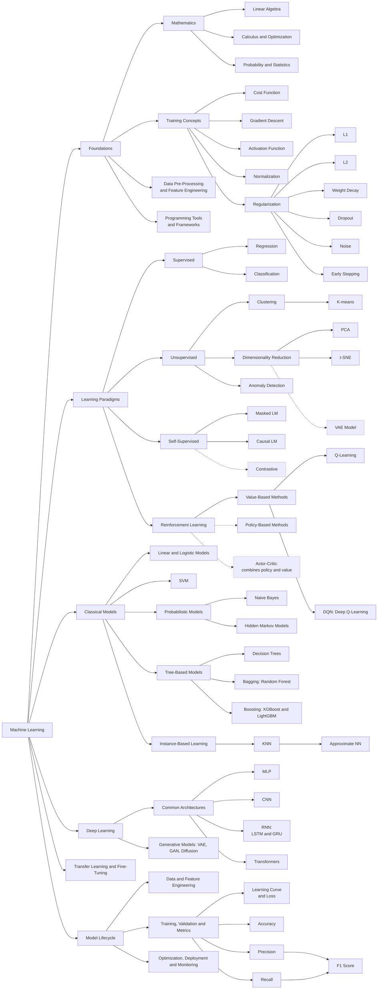

# Practicals and Experiments of Machine Learning and Deep Learning

## Table of Contents

- [Welcome and Foreword](#welcome-and-foreword)
- [Machine Learning Workflow](#machine-learning-workflow)
- [Knowledge Maps](#knowledge-maps)
  - [Mathematics](#mathematics)
  - [Programming Environment](#programming-environment)
  - [Frameworks and Tools](#frameworks-and-tools)
  - [Model Architectures and Components](#model-architectures-and-components)
  - [Training, Evaluating and Tuning](#training-evaluating-and-tuning)
  - [Optimization and Deployment](#optimization-and-deployment)
- [Overview of Projects](#overview-of-projects)
  - [Fundamentals of Machine Learning](#fundamentals-of-machine-learning)
  - [Text and NLP Models](#text-and-nlp-models)
  - [Vision Models](#vision-models)
  - [Deployment](#deployment)
- [Conclusion](#conclusion)

## Welcome and Foreword

Hi, Welcome to the page! 😀

This repository documents my hands-on learning in machine learning and deep learning through study notes, practical experiments and working codes. As a software engineer with years of programming experience, I’m interested in connecting the ideas behind a model to how it is implemented, trained, evaluated and prepared for use. 

Even after many years of programming, I still found deep learning to be a very different experience from classical software development. It feels more like learning how intelligence emerges from data and computation, it is full of creativity. Like learning any new subject, it begins with simple ideas before developing into more complex systems.

It is a broad roadmap for machine learning, covering a wide range of topics, methods and application areas. However the knowledge maps and projects shown here is only a subset of the field and a selected portion that I've mastered. They span the foundations of machine learning, including classical statistical, probabilistic, tree-based and unsupervised methods, reinforcement learning and deep learning for computer vision (CV) and natural language processing (NLP). They also cover transfer learning and fine-tuning, along with the practical workflow of optimization, evaluation, and deployment. The route map below connects these areas to representative methods and architectures.

I use this repository to organize concepts, make connections between methods and build understanding through implementation. It reflects an ongoing learning journey with an emphasis on clear explanations and practical exploration rather than claiming expertise in every area.

## Machine Learning Workflow

From the idea to a production-ready system, a machine learning project typically follows a clear workflow. It usually includes:

* Data Collection
* Data Cleaning and Preparation
* Model Architecture
* Model Training
* Evaluation
* Compression and Deployment

Different types of data may require different preprocessing, training, and evaluation techniques, but the overall workflow remains broadly consistent.

## Knowledge Maps

### Mathematics

A solid foundation in *linear algebra*, *calculus*, *probability*, and *statistics* is essential for understanding how models learn and why they behave the way they do. These concepts support a deeper understanding of training dynamics, optimization, inference, and model behavior in real applications.

Key topics frequently used in ML include:
* Linear algebra: vectors, matrices, tensor operations, matrix factorization
* Calculus: derivatives, gradients, chain rule
* Probability and statistics: conditional probability, Bayes' theorem, expectation, variance, distributions and maximum likelihood
* Information theory: entropy, cross-entropy, KL divergence and information gain
* ...

In practical applications, some common concepts include:
* Naive Bayes
* Laplace Smoothing
* Log Likelihood
* Euclidean Distance
* Cosine Similarity
* Markov Chain
* Transition Probability
* Dot Product
* ...

### Programming Environment

`Python` is the primary language used throughout this learning journey. It offers a rich ecosystem of tools and libraries that make experimentation, model training, and data analysis efficient and accessible. In addition to Python, I have also worked with *Java*, *C*, *Ruby*, *PHP*, *JavaScript*, and other languages, but Python remains the most practical choice for machine learning work.

### Frameworks and Tools

`PyTorch` is the main deep learning framework used in this project, while `TensorFlow` is another widely adopted option in the field. Both are commonly used for building and training machine learning models.

Beyond the frameworks themselves, tools such as `NumPy`, `Pandas`, `scikit-learn`, `keras` and `Matplotlib` are essential for data processing, model evaluation, and visualization. These libraries help transform raw data into meaningful insights and make model comparison more intuitive.

### Model Architectures and Components

I have explored several common model families and classic architectures, including:

* CNN
    * LeNet-5
    * AlexNet
    * VGG-16
    * ResNet
    * Inception Net
    * MobileNet
    * EfficientNet
* RNN
    * GRU
    * LSTM
    * Bi-RNN
* NLP
    * Tokenization
    * Word Embedding (Vector Space Models)
        * KNN
        * ANN (LSH)
    * Sequence-to-Sequence Models
    * Probabilistic Models
        * Naive Bayes Classification Models (Laplacian Smoothing + Log Likelihood)
        * Markov Models
    * Transformer Models
* Transformer
    * Attention Model
    * Encoder
    * Decoder
    * Common Models
        * BERT
        * GPT
        * T5
        * Prefix LM

### Training, Evaluating and Tuning

Models can be built using different architectures, including methods that are not based on neural networks. In general, neural network models are commonly trained using `Gradient Descent` along with a chosen `Loss Function`, `Optimizer` and `Scheduler`. During training, it is also important to evaluate the model using appropriate metrics such as `Loss`, `Accuracy`, `Precision` and `Recall` while keeping an eye on efficiency and memory usage.

For hyperparameter tuning, `Optuna` can automate trials over a defined search space, using validation performance as the objective and pruning unpromising trials.

### Optimization and Deployment

Once a model is trained, additional work is often required before it is ready for deployment.

Converting a model to an inference engine is a common step. This may involve exporting it to `ONNX` or another format to support cross-platform deployment and improve runtime performance.

Before deployment, optimization techniques such as `pruning` and `quantization` can significantly reduce model size and improve efficiency. In addition, tools such as `MLflow` can help with experimentation, tracking, and model monitoring throughout the training lifecycle.

## Overview of Projects

### Fundamentals of Machine Learning

The fundamentals section is the starting point for understanding how machine learning models actually learn from data. These experiments focus on the simplest but most important ideas in the field: optimization, regression, classification, and the visual intuition behind training dynamics. Rather than jumping directly into large neural networks, the goal here is to build a clear mental model of loss, gradients, parameter updates, and the role of data distribution.

The experiments in [Fundamentals/](./Fundamentals/README.md) cover a practical learning path from basic math to visual model fitting:

* Manual gradient descent: [basic_manual_gradient.py](./Fundamentals/basic_manual_gradient.py) implements the update rule by hand for a simple linear model. This is the clearest way to see how gradients are computed, how the learning rate affects convergence, and why repeated small updates eventually minimize the loss.
* PyTorch-style gradient descent: [basic_pytorch_gradient.py](./Fundamentals/basic_pytorch_gradient.py) reproduces the same idea using automatic differentiation in PyTorch, showing how the framework handles the forward pass, backward pass, and optimizer step behind the scenes.
* Linear regression: [multi_dimensions.py](./Fundamentals/multi_dimensions.py) trains a multi-feature model using two input variables and a multi-output regression target. It demonstrates how a linear model learns a weight matrix and bias from data, which is the foundation for more complex networks.
* Logistic regression and binary classification: [binary_category.py](./Fundamentals/binary_category.py) uses a sigmoid output and binary cross-entropy to separate two classes. The script also draws the decision boundary dynamically in Matplotlib, making the classification boundary visually obvious as training progresses.
* Dynamic convergence plotting: [simple_linear_dynamic.py](./Fundamentals/simple_linear_dynamic.py) and [simple_curve_dynamic.py](./Fundamentals/simple_curve_dynamic.py) animate the model fitting process in real time. Watching the predicted line or curve move toward the target data makes gradient descent and loss reduction much easier to understand than static plots alone.
* Curve fitting in 2D with Matplotlib: [quadratic_draw.py](./Fundamentals/quadratic_draw.py) fits a parabola of the form `y = 3x^2 + 20` with a small neural network. This is a useful exercise for seeing how nonlinear functions can be approximated and how regression differs from simple linear fitting.
* Data distribution and statistics basics: [rand_normal_distribute.py](./Fundamentals/rand_normal_distribute.py) compares uniform and normal distributions, helping to build intuition for data generation, probability shapes, and the importance of distribution-aware modeling.
* Similarity-based learning: [knn_cosine_similarity.py](./Fundamentals/knn_cosine_similarity.py) introduces a simple nearest-neighbor style approach and cosine similarity, which is useful for understanding similarity metrics and feature comparison.

Together, these experiments form the foundation of the rest of the repository. They are intentionally simple, but they are the practical building blocks behind deeper topics such as neural networks, optimization methods, and modern deep learning models. The key idea is not just to train a model, but to understand why it learns, how it can fail, and how visual feedback makes the learning process interpretable.

### Text and NLP Models

The Text-and-NLP projects explore an end-to-end path from raw text to language applications. They cover tokenization and vocabulary building, word embeddings, and traditional sequence models such as RNNs and LSTMs. Practical tasks include text classification, named entity recognition, sentiment analysis, next-word prediction, text generation, summarization, and question answering. The Transformer examples build up positional encoding, attention, encoder and decoder components, while algorithm exercises introduce n-gram prediction and minimum edit distance.

[Explore the Text and NLP projects](./Text-and-NLP/README.md) for explanations and examples, including [tokenization](./Text-and-NLP/tokenization.py), [text classification](./Text-and-NLP/text_classifier.py), [LSTM-based named entity recognition](./Text-and-NLP/lstm_ner.py), [Transformer summarization](./Text-and-NLP/transformer_summary.py), and [n-gram prediction](./Text-and-NLP/n_grams_predict.py).

### Vision Models

The VisionLab projects centered on PyTorch and convolutional neural networks. They focus on how CNNs interpret images, explain how certain regions matter for recognition and how modern generative models create new visual content from noise as `diffusion model`. The experiments cover feature maps, saliency analysis, Grad-CAM-style class activation mapping, and diffusion-based image generation, showing both the interpretability and creativity of modern vision systems.

These works help build intuition for core computer vision ideas: visualizing intermediate activations, highlighting influential pixels, explaining model decisions, and exploring denoising for image synthesis.

### Deployment

The Deployment projects focus on the final stage of the ML lifecycle: turning a trained model into something reusable, portable, and efficient in real-world use. These examples cover checkpoint saving and training resume, model serialization, experiment tracking with Lightning and MLflow, exporting to ONNX for cross-platform inference, and optimization through pruning and quantization. The goal is to move from a notebook-trained model to a deployment-ready workflow with better reliability and performance.

[Explore the Deployment projects](./Deployment/README.md) for checkpointing, ONNX export, and model optimization examples.

## Conclusion

This page is intended to provide a broad overview of my learning journey in machine learning and deep learning. It is still being updated as I continue to explore new topics and deepen my understanding.

All of the notes and annotations here reflect my personal learning process and are not intended as formal teaching material. If you notice any mistakes or have suggestions for improvement, I would be very glad to hear from you.

Thanks for reading!
