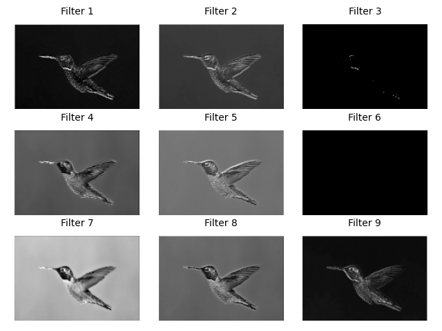
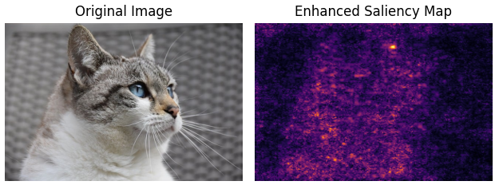
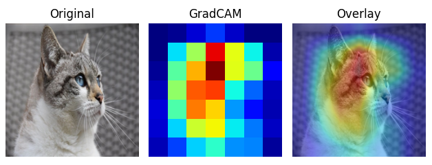
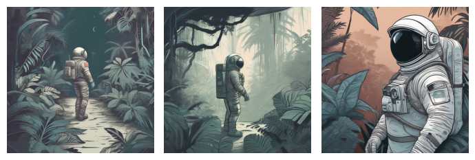
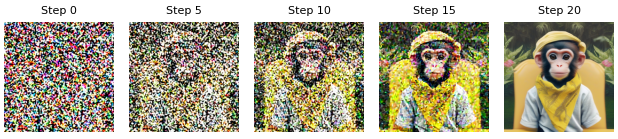
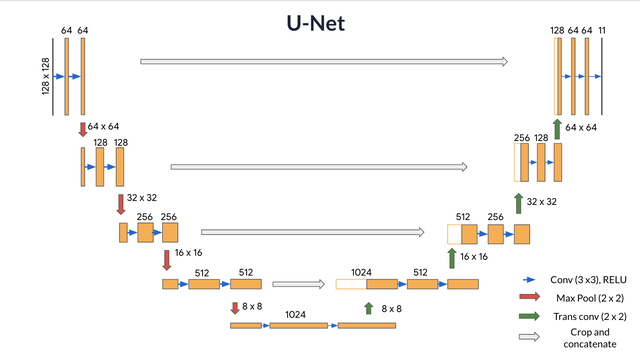

# Vision Specialized Laboratory

This section contains hands-on PyTorch experiments in computer vision, exploring how neural networks process images and tackle tasks such as classification, segmentation and generation. Some parts of topics is seperated in respective directory, you could follow the link if intrested.

**Data Preparation** is an important first step, see the [Oxford Flowers102 data preparation](../Flowers102/README.md) for an example of building a custom dataset and applying preprocessing.

For **Image Classification** hands-on exercises, start with [MNIST-train](../MNIST-train/README.md) and [EMNIST-train](../EMNIST-train/README.md), which cover handwritten-digit and letter classification. For a more advanced example with optimized training and model improvements, see [CIFAR-100-train](../CIFAR-100-train/README.md).

**Object Detection** has evolved from repeatedly scanning an image to predicting objects in a single network pass. Early **sliding-window** methods classified image crops at many positions and scales, making them computationally expensive. **Convolutional sliding-window** methods improved efficiency by reusing convolutional features across overlapping regions. **Intersection over Union (IoU)** measures the overlap between predicted and ground-truth boxes, while **non-max suppression (NMS)** uses overlap to filter duplicate detections. Classic detectors use **anchor boxes** predefined shapes and sizes that the model adjusts to fit objects. **YOLO** advanced one-stage detection by predicting boxes and classes in a single pass. **YOLOv8** and some later versions are anchor-free while others use anchors.

The section below introduce a more advanced image process insights, includes:

* [Feature maps](#feature-maps)
* [Saliency maps](#saliency-maps)
* [Class activation maps](#class-activation-maps)
* [Diffusion model](#diffusion-model)
* [YOLO model](#yolo)
* [U-Net Architecture](#u-net)
* [Siamese network](#siamese-network)

### Feature Maps

What's the output of the conv layer? What do they do after images pass through a conv layer and max pool? How do filters affect the results? We'll retrieve the output of a layer and display every channel using plot, that's called `feature maps`.

#### feature_map.py

```python
# read the image
image = Image.open(current_dir / "imgs/bird.jpg")
# convert to tensor
image_tensor = transforms.ToTensor()(image)

# display
# utils.plot_image(image_tensor)

# conv block
conv_block = nn.Sequential(
    nn.Conv2d(in_channels=3, out_channels=16, kernel_size=3, stride=1, padding=1),
    nn.ReLU(),
    nn.MaxPool2d(kernel_size=2, stride=2),
    nn.Conv2d(in_channels=16, out_channels=9, kernel_size=3, stride=1, padding=1),
    nn.ReLU(),
    nn.MaxPool2d(kernel_size=2, stride=2)
)
# apply the convolutional layer to the image
output_conv_layer = conv_block(image_tensor)

utils.plot_channels(output_conv_layer)
```




### Saliency Maps

Take a example for image classification, which of those pixels by input has big influence on the prediction? How do we visualize them? That comes to `saliency maps` which can measure input images pixel by pixel to reveal which parts most affect the prediction.



### Class Activation Maps

Instead of showing high lights of pixels, with `Grad-CAM` (Gradient weighted Class Activation Mapping), we can show regions on original image with influences. That make more sense. 

The main idea is based on feature maps. Since each feature map represents from a special angle, all the feature maps reflects what a neural network seen. Therefore we grab the activations from last layer which directly affects prediction, also with backward gradients.
Calculate average gradients as weights of correlative feature map, then sum up all the feature maps multipled by their weights. Finally smoothing with interpolation and stack back to the top of original image, we got our heat map.

**Note:** There're two ways of using hook to grab gradient.

1. You can register your hook function on target layer by using `register_forward_hook` and `register_full_backward_hook`
2. You can register hook **ONLY FOR** target tensor with `register_hook`





### Diffusion Model

It's a generative model for images other than discriminative, diffusion models can generate creative images according to your prompts.

The process is training a model to learn **accumulate noise** at first, then using that learned noise to predict the noise one step before, then implements this operation over and over, eventually reach the orginal image. The progress is known as "denoise" gradually.

We'll use the [Stable Diffusion XL-1.0-base](https://huggingface.co/stabilityai/stable-diffusion-xl-base-1.0) model from Hugging Face with `Diffusers` tool to accomplish the task.

```bash
pip install -U diffusers transformers accelerate
```



Other than playing with the model, we also inspect the progress during the denoising. With pipeline's callback functionality, we capture intermediate images to visualizing the steps.



**Caution**: If runnning with float16 by SD-XL-1.0-base，there is a VAE bug when decoding the latent. You need to fix this issue with `AutoencoderKL` from community.

```python
from diffusers import DiffusionPipeline, AutoencoderKL

# fixed for float16 from community
vae = AutoencoderKL.from_pretrained(
    "madebyollin/sdxl-vae-fp16-fix",
    torch_dtype=torch.float16
)

pipe = DiffusionPipeline.from_pretrained(
    repo_id, 
    vae=vae,  # substitute with AutoencoderKL
    torch_dtype=torch.float16, 
    variant="fp16", 
    cache_dir=cache_dir,
    local_files_only=model_is_cached
)
```

**Conceptual Notes:**

* **DDPM**: it's the fundament of Stable Diffusion, mainly create images through two phase:
  - forward process
  - reverse process
* **Pixel space DDPM**  vs. **Latent space Diffusion**
  - **latent space** is compressed features from original image which makes them much more efficient and scalable, but less intuitive to visualize.
  - we can use an autoencoder to compress images to latent space and decode back to pixels.

### YOLO

**YOLO** is a family of one-stage object detectors. Rather than proposing regions and classifying them in separate stages, YOLO detector predicts object locations and classes directly from an image in a single network pass. This makes detection fast enough for real-time applications, while successive versions have improved accuracy, scale handling, and efficiency.

With the evolution of YOLO, it has multiple versions:

* **YOLOv1:** Established single-pass detection with grid-based box and class predictions.
* **YOLOv2 / YOLO9000:** Added anchor boxes and a passthrough layer for fine-grained features; also introduced multi-scale training.
* **YOLOv3:** Predicted at three feature-map scales, improving detection across object sizes.
* **YOLOv5:** Popularized an accessible PyTorch implementation and practical model-size variants. It is an Ultralytics implementation, distinct from the original authors' paper series.
* **YOLOv8:** Popularized an anchor-free, decoupled detection head and a broader family of vision tasks.
* **YOLOv10:** Advanced end-to-end detection with a training strategy designed to remove the need for NMS.
* **YOLO26:** Ultralytics' 2026 model family adds native end-to-end inference, a lighter detection head, and updated training methods. Its NMS-free path is optional.

some of the key ideas used in YOLO:

* **Grid-based prediction:** In YOLOv1, the image was divided into an `S x S` grid. A cell was responsible for an object when the object's center fell inside it.
* **Backbone, neck, and head:** The backbone extracts visual features, the neck combines features at different resolutions, and the head predicts boxes and classes. 
* **Anchor boxes and anchor-free:** Anchor-based models predict adjustments to predefined box shapes. Anchor-free models predict box locations or distances without those predefined shapes.
* **IoU and losses:** Intersection over Union (IoU) measures overlap between a predicted and target box. YOLOv1 used squared-error terms for box coordinates and confidence, not an IoU loss. Later versions adopted IoU-based losses.
* **Non-maximum suppression (NMS):** Traditional YOLO inference ranks overlapping predictions and removes duplicates with NMS. End-to-end variants such as YOLOv10 and YOLO26 can avoid this step.

### U-Net

U-Net is a convolutional neural network designed for image segmentation, especially when precise pixel-level predictions matter. Its encoder-decoder structure captures context through downsampling, while the decoder reconstructs spatial details using skip connections and upsampling via transpose convolutions, allowing the model to preserve fine boundaries and local structure. 



### Siamese network

A Siamese network processes two or more inputs with copies of the same network that share their weights, mapping each input to an embedding in a common feature space. Comparing the embeddings lets the model learn whether inputs are similar rather than assigning each one a fixed class. This makes Siamese networks useful for tasks such as signature verification and matching examples not seen during training.

See the [Siamese network](../siamese-network/README.md) for a signature verification example using triplet loss.


