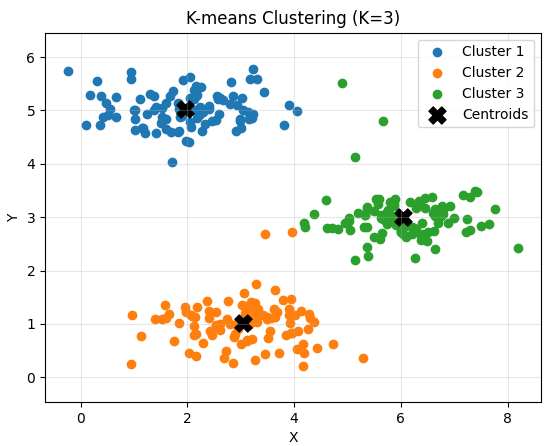
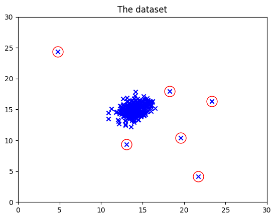

# Unsupervised Learning

Unsupervised learning helps discover patterns and structure in data without labeled examples. Common approaches include `clustering` similar data points, `reducing dimensions` to reveal important features, and `detecting unusual observations`. It is useful for exploring datasets and uncovering groups or relationships that were not specified in advance.

## Clustering

Clustering is an unsupervised learning technique that groups data points based on their similarity without requiring predefined labels. A common method is `K-means` which partitions data into a chosen number of clusters through two repeating steps:

1. **Assign points:** Assign each data point to its nearest cluster center (centroid).
2. **Update centers:** Recalculate each centroid as the mean of the points assigned to that cluster.

Repeat these steps until the assignments or centroids stop changing. Clustering can reveal patterns such as customer groups or similar documents.

The results of [k-means sample](./k_means.py) shows below:



## Anomaly Detection

Anomaly detection identifies observations that differ substantially from the patterns in the majority of the data. It is useful for finding unusual transactions, equipment failures, or suspicious network activity, especially when labeled examples of anomalies are scarce.

One approach models normal data with a `Gaussian distribution`. After estimating the mean and variance of each feature from normal examples, the model learns the distribution of the normal data, observations with low probability are flagged as anomalies. This approach works best when normal data is reasonably well described by the chosen distribution.

Estimate the Gaussian parameters as:

$$
\mu_j = \frac{1}{m}\sum_{i=1}^{m} x_j^{(i)}, \qquad
\sigma_j^2 = \frac{1}{m}\sum_{i=1}^{m}\left(x_j^{(i)}-\mu_j\right)^2
$$

Feature scaling and a suitable validation strategy are important when comparing methods and choosing a threshold. We need to select a threshold based on a cross validation set with labeled data by `F1-score`.



Other methods make different assumptions about what makes an observation unusual.

## Dimension Reduction


## Recommender System

### Collaborative filtering

Collaborative filtering recommends items based on patterns in user-item interactions, such as ratings or clicks. It can suggest items liked by users with similar preferences, or items similar to those a user has liked. It does not require item descriptions, but sparse interaction data can make recommendations less reliable.

In [recommender_collaborative.py](./recommender_collaborative.py), we build a collaborative-filtering recommender using ratings from many users.

After training the model, we compare the ratings provided for a new user with the model's predicted ratings for those movies. The results are shown below.

| Movie | Rated | Predicted | Difference |
|---|---:|---:|---:|
| Shrek (2001) | 5.00 | 4.32 | -0.68 |
| Harry Potter and the Sorcerer's Stone (2001) | 5.00 | 4.22 | -0.78 |
| Amelie (Fabuleux destin d'Amélie Poulain, Le) (2001) | 2.00 | 2.25 | +0.25 |
| Harry Potter and the Chamber of Secrets (2002) | 5.00 | 5.00 | -0.00 |
| Pirates of the Caribbean: The Curse of the Black Pearl (2003) | 5.00 | 4.67 | -0.33 |
| Lord of the Rings: The Return of the King, The (2003) | 5.00 | 5.00 | +0.00 |
| Eternal Sunshine of the Spotless Mind (2004) | 3.00 | 4.00 | +1.00 |
| Incredibles, The (2004) | 5.00 | 4.47 | -0.53 |
| Persuasion (2007) | 2.00 | 2.46 | +0.46 |
| Toy Story 3 (2010) | 5.00 | 4.23 | -0.77 |
| Inception (2010) | 3.00 | 3.44 | +0.44 |
| Louis Theroux: Law & Disorder (2008) | 1.00 | 1.72 | +0.72 |
| Nothing to Declare (Rien à déclarer) (2010) | 1.00 | 1.49 | +0.49 |

The model recommends

```text
Top recommendations:
6.95 - Quest (2017)
6.88 - Pineapple Express (2008)
6.66 - Filth (2013)
6.47 - Eva (2011)
6.37 - Snowflake, the White Gorilla (2011)
6.36 - Alesha Popovich and Tugarin the Dragon (2004)
6.30 - Death Note Rewrite: Genshisuru Kami (2007)
6.28 - Spider-Man 2 (2004)
6.12 - Me and you (io e te) (2012)
6.08 - Last Life in the Universe (Ruang rak noi nid mahasan) (2003)
```

### Content-based filtering

Content-based filtering recommends items with features similar to those a user has liked before. It builds a profile of the user's preferences from item attributes, such as genres, keywords, or product categories, and matches that profile to other items. It can make recommendations without data from other users, but depends on having useful item features.